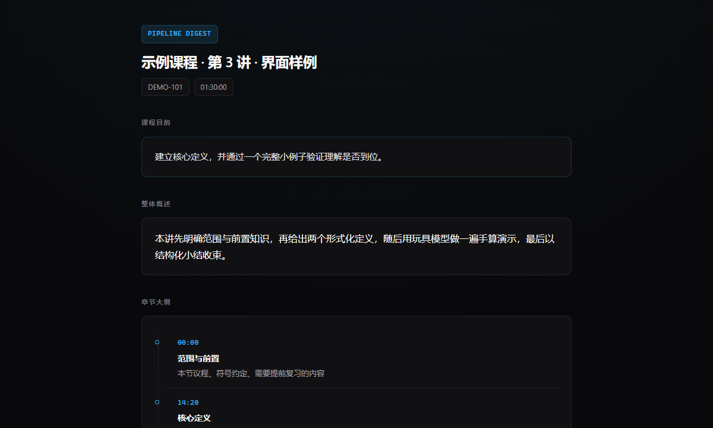
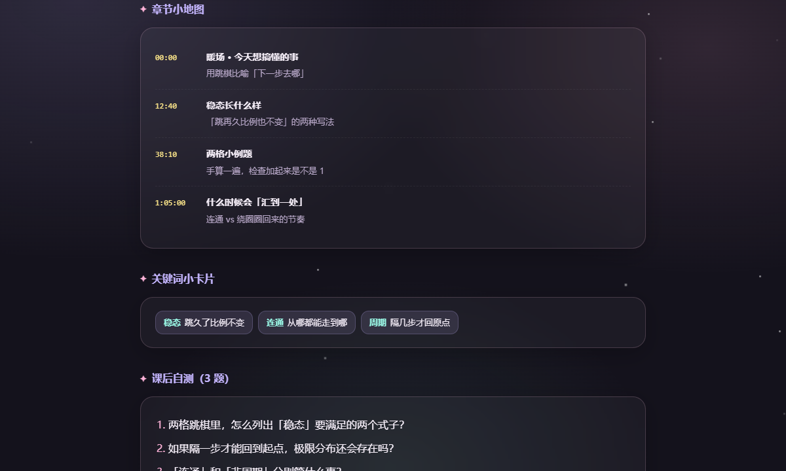
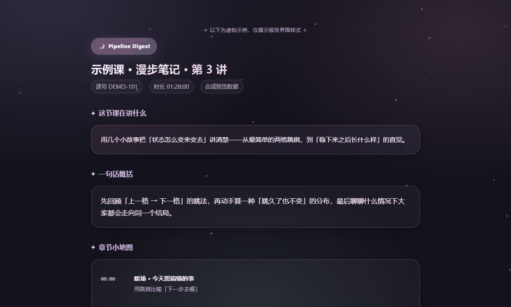
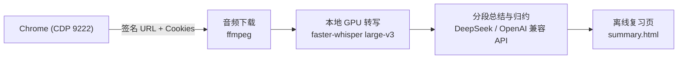

# fudan_pipeline-digest

`v1.0.0` · `Python 3.12+` · `faster-whisper GPU` · `DeepSeek` · [MIT License](LICENSE)

> 如果你也在 icourse 上反复拖进度条找「老师刚才那句到底说了啥」——这个项目就是替你干这件事的。

---

**fudan_pipeline-digest** 是一条跑在本地的课堂复习流水线：你在浏览器里**本来就有权观看**的课堂录像，丢进来之后，它会自动完成 **GPU 转写 → LLM 分段整理 → 生成离线 HTML 复习页**。  
不用手动下载、不用复制粘贴字幕，跑完打开 `summary.html`，课程大纲、核心概念、时间戳与自测题都在里面。

> [!NOTE]
> Cookie 和 API Key 只留在你的本机硬盘上；仓库里只有源码，以及下方**虚构内容的界面预览**（不含任何真实师生信息）。

---

## 核心能力 · Highlights

- **省复习时间** — 2–3 小时的课，输出带时间戳的结构化复习笔记，不用从头拖进度条
- **本地 GPU 转写** — `faster-whisper` `large-v3`，显存充足时比纯 CPU 快一个数量级
- **断点续跑不白费** — DeepSeek Map-Reduce 分段总结，中途中断可从 `section_notes.json` 直接续跑
- **离线即开即用** — 深色主题 `summary.html` 复习报告，浏览器双击即可阅读，无需联网

适合：想系统复习、快速定位知识点、批量整理一门课所有回放的同学。  
不适合：没有合法访问权限的录像——请勿用于越权场景。

---

## 报告预览 · Preview

合成样例（`render_html` 真实输出样式，内容为虚构）：

| 概览与学习目标 | 时间轴与章节大纲 |
| :---: | :---: |
|  |  |

<details>
<summary>展开查看完整滚动预览（GIF）</summary>
<p align="center">
  
</p>
</details>

本地也可直接打开示例报告 → [docs/showcase/preview.html](./docs/showcase/preview.html)

---

## 流水线架构 · Architecture



各模块职责与设计取舍 → [docs/ARCHITECTURE.md](./docs/ARCHITECTURE.md)

环境要求：**Python 3.12+** · **ffmpeg 8+** · **NVIDIA GPU（推荐）** · **DeepSeek 或兼容 API**

---

## 快速上手 · Quick Start

### 1. 安装依赖与配置

```bash
git clone https://github.com/yokipan77-gif/fudan_pipeline-digest.git
cd fudan_pipeline-digest
pip install -r requirements.txt
cp config.example.json config.json   # 填好 deepseek_api_key 和 ffmpeg_path
```

### 2. 运行前检查（每次都要确认）

1. 已连上校园 VPN，浏览器能正常打开 icourse
2. **关闭 Clash 等系统代理** — 开启代理时 CDP 连接经常失败
3. Chrome 已登录 icourse，并以远程调试端口 `9222` 启动

### 3. 处理课程录像

处理单节课：

```bash
python -m src.pipeline "https://icourse.fudan.edu.cn/livingroom?course_id=COURSE_ID&sub_id=SUB_ID"
```

整门课批量处理：

```bash
python -m src.pipeline --course-id COURSE_ID --all
```

生成报告位于：`output/<课程名>/<节次名>/summary.html`

中途中断后断点续跑：

```bash
python -m src.pipeline "..." --skip-cookies --skip-download --skip-transcribe
```

更多参数说明 → [USAGE.md](./USAGE.md) · 分模块排查 → [TEST.md](./TEST.md) · 辅助诊断脚本位于 [`scripts/`](./scripts/)

---

## 常见问题 · FAQ

<details>
<summary><strong>Q：CDP 连不上 / 拿不到签名 URL</strong></summary>

八成是 Clash 等系统代理还在运行。关闭系统代理，在 Chrome 中打开 livingroom 页面并保持播放，再重试一次。
</details>

<details>
<summary><strong>Q：ffmpeg 报 403</strong></summary>

签名 URL 已过期（有效期约 30 分钟）。去掉 `--skip-download`，重新运行下载步骤即可。
</details>

<details>
<summary><strong>Q：Whisper 模型下载很慢</strong></summary>

首次运行需下载约 3 GB 的 `large-v3` 模型权重。下载完成后会缓存在本地 `cache/` 目录，后续运行无需重复下载。
</details>

<details>
<summary><strong>Q：DeepSeek 总结跑一半卡住，终端几分钟无输出</strong></summary>

通常处于 reduce 汇总阶段，属正常现象。若真发生超时直接重跑即可——已完成的片段保存在 `section_notes.json` 中不会丢失。
</details>

<details>
<summary><strong>Q：GPU 没在工作，CPU 转写非常慢</strong></summary>

请检查 `config.json` 中 `whisper_device` 是否为 `cuda`，并确认本机 CUDA 驱动与 PyTorch/CTranslate2 环境正常。
</details>

<details>
<summary><strong>Q：预览页控制台提示 <code>favicon.ico</code> 404</strong></summary>

并非 bug。浏览器会自动请求站点图标，离线目录里不含该文件，不影响 `preview.html` / `summary.html` 正常浏览。
</details>

---

## 隐私与合规

请仅处理你有合法访问权限的课程录像，并遵守学校平台使用规定。  
切勿将 `config.json`、`cookies/`、`output/`、`cache/` 提交到 Git。

---

## License

本项目基于 [MIT License](./LICENSE) 开源。开发者：**复旦yoki**。
